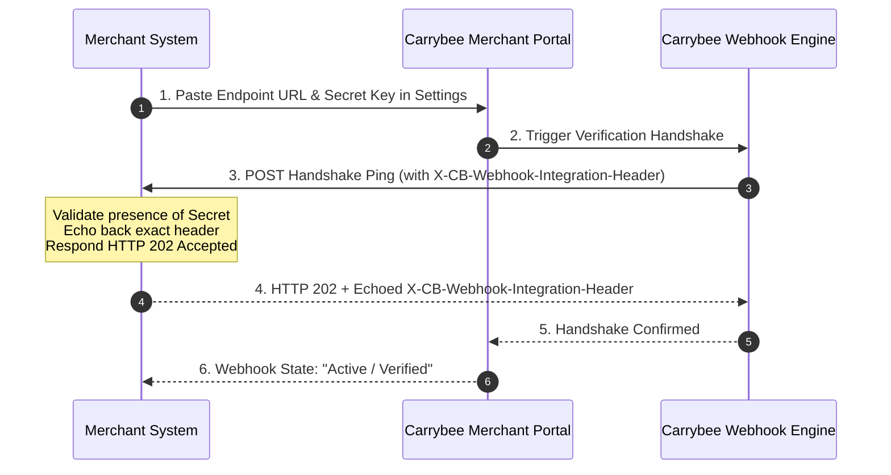

# Carrybee Webhooks & Handshake Protocol

Carrybee utilizes webhooks to provide real-time status updates across 24 lifecycle events—ranging from order placement, sorting hub movements, and last-mile dispatch to partial delivery, returns, and exchanges.

---

## 1. Webhook Handshake Protocol (Registration Verification)

Unlike standard webhook setups where endpoints merely accept incoming payloads, Carrybee enforces an **initial registration handshake** to verify endpoint authenticity and responsiveness before activating event delivery.



### Handshake Requirements:
1. **HTTP Status Code**: Your endpoint **must return HTTP 202 Accepted** during handshake and subsequent events.
2. **Echoed Header**: Your response **must include** the response header `X-CB-Webhook-Integration-Header` holding the exact secret string configured in the Carrybee portal.
3. **Payload Structure**: The handshake request body includes a verification test payload:
   ```json
   {
     "type": "handshake",
     "message": "Carrybee webhook verification handshake",
     "timestamp": "2026-10-27T10:00:00.000Z"
   }
   ```

---

## 2. All 24 Webhook Events

Carrybee dispatches events for every operational checkpoint:

| # | Event Name (`event` / `type`) | Stage | Operational Meaning |
|---|-------------------------------|-------|---------------------|
| 1 | `order.created` | Booking | Order booked and recorded in Carrybee system |
| 2 | `order.create-failed` | Booking | Booking rejected due to routing/weight/validation error |
| 3 | `order.updated` | Admin | Order metadata or destination updated by merchant |
| 4 | `order.pickup-requested` | First Mile | Rider pickup request scheduled |
| 5 | `order.assigned-for-pickup` | First Mile | Rider assigned with phone number for pickup |
| 6 | `order.picked` | First Mile | Parcel physically collected from merchant warehouse |
| 7 | `order.pickup-failed` | First Mile | Merchant shop closed, parcel not ready, or inaccessible |
| 8 | `order.pickup-cancelled` | First Mile | Pickup cancelled by merchant or rider |
| 9 | `order.at-the-sorting-hub` | Hub Logistics | Parcel reached local mother hub / origin hub |
| 10 | `order.on-the-way-to-central-warehouse` | Line-haul | Dispatched on transit vehicle to Central Sorting Center |
| 11 | `order.at-central-warehouse` | Hub Logistics | Scanned inside central sorting hub |
| 12 | `order.in-transit` | Line-haul | Moving between hubs towards destination district hub |
| 13 | `order.received-at-last-mile-hub` | Last Mile | Arrived at destination branch/sub-hub |
| 14 | `order.assigned-for-delivery` | Last Mile | Assigned to last-mile delivery rider (Out for Delivery) |
| 15 | `order.delivery-on-hold` | Last Mile | Customer requested later delivery / reschedule |
| 16 | `order.delivered` | Terminal | Full delivery completed, COD collected |
| 17 | `order.partial-delivery` | Terminal | Customer accepted partial items, updated COD collected |
| 18 | `order.delivery-failed` | Terminal | Delivery attempt failed (customer unreachable/refused) |
| 19 | `order.returned` | Reverse | Final return approved, heading back to merchant |
| 20 | `order.paid-return` | Reverse | Returned with courier return charge billed |
| 21 | `order.exchange` | Exchange | Exchange parcel delivered and replacement collected |
| 22 | `order.paid` | Finance | Settlement complete, invoice generated to merchant bank |
| 23 | `order.returned-at-sorting` | Reverse Line-haul | Return parcel scanned at reverse sorting hub |
| 24 | `order.returned-to-merchant` | Reverse Terminal | Parcel returned back into merchant's physical possession |

---

## 3. Webhook Payload Schema

Every webhook event POST contains a structured JSON payload:

```json
{
  "event": "order.delivered",
  "consignment_id": "CB-982341",
  "merchant_order_id": "INV-2026-9901",
  "order_status": "delivered",
  "collected_amount": 1850.00,
  "delivery_fee": 70.00,
  "cod_fee": 18.50,
  "rider": {
    "name": "Kamrul Hassan",
    "phone": "01700998877"
  },
  "recipient": {
    "name": "Tanvir Ahmed",
    "phone": "01811223344",
    "address": "House 12, Road 4, Sector 7, Uttara, Dhaka"
  },
  "timestamp": "2026-10-27T11:45:00+06:00",
  "remarks": "Delivered successfully with OTP verification"
}
```

---

## 4. Production Webhook Handlers

### A. Node.js & Express.js Implementation

```javascript
/**
 * Carrybee Webhook Receiver with Handshake & Idempotency
 * Author: Refat Rahman (https://refat.ovh | @refatbd)
 */
const express = require('express');
const app = express();

app.use(express.json());

const CARRYBEE_WEBHOOK_SECRET = process.env.CARRYBEE_WEBHOOK_SECRET || 'cb_wh_sec_your_secret_here';

app.post('/api/carrybee/webhook', async (req, res) => {
  const incomingSecret = req.headers['x-cb-webhook-integration-header'];

  // 1. Authenticate webhook origin
  if (!incomingSecret || incomingSecret !== CARRYBEE_WEBHOOK_SECRET) {
    console.warn('[Carrybee Webhook] Unauthorized request attempt');
    return res.status(401).json({ error: 'Unauthorized webhook request' });
  }

  // 2. Set mandatory response header
  res.setHeader('X-CB-Webhook-Integration-Header', CARRYBEE_WEBHOOK_SECRET);

  const payload = req.body;

  // 3. Handle Handshake verification ping
  if (payload.type === 'handshake') {
    console.log('[Carrybee Webhook] Handshake verified successfully');
    return res.status(202).json({
      status: 'handshake_accepted',
      message: 'Carrybee webhook handshake acknowledged'
    });
  }

  // 4. Process operational events asynchronously
  const { event, consignment_id, merchant_order_id, order_status } = payload;
  console.log(`[Carrybee Webhook] Event: ${event} | Consignment: ${consignment_id} | Order: ${merchant_order_id}`);

  try {
    switch (event) {
      case 'order.delivered':
        // Update database: mark order as completed & credit ledger
        break;

      case 'order.partial-delivery':
        // Handle partial items adjustment and update balance
        break;

      case 'order.returned-to-merchant':
        // Restock inventory for returned SKU
        break;

      case 'order.assigned-for-delivery':
        // Notify customer via SMS with rider contact details
        break;

      default:
        console.log(`[Carrybee Webhook] Tracking event logged: ${order_status}`);
    }

    // Always respond with 202 Accepted
    return res.status(202).json({
      received: true,
      consignment_id: consignment_id,
      status: 'acknowledged'
    });
  } catch (err) {
    console.error('[Carrybee Webhook Error]', err);
    // Return 202 to avoid webhook spam, log failure internally for retry queue
    return res.status(202).json({ received: true, error_logged: true });
  }
});

app.listen(3000, () => console.log('Carrybee webhook listener active on port 3000'));
```

---

### B. Laravel 10/11 Implementation

#### 1. Middleware / Controller (`app/Http/Controllers/CarrybeeWebhookController.php`)

```php
<?php

namespace App\Http\Controllers;

use Illuminate\Http\Request;
use Illuminate\Http\JsonResponse;
use Illuminate\Support\Facades\Log;

/**
 * Class CarrybeeWebhookController
 * Handles Carrybee Delivery API v2 Webhooks & Handshake Echo
 *
 * @author Refat Rahman <https://refat.ovh>
 */
class CarrybeeWebhookController extends Controller
{
    public function handle(Request $request): JsonResponse
    {
        $expectedSecret = config('services.carrybee.webhook_secret', env('CARRYBEE_WEBHOOK_SECRET'));
        $incomingSecret = $request->header('X-CB-Webhook-Integration-Header');

        // 1. Authenticate secret token
        if (!$incomingSecret || !hash_equals($expectedSecret, $incomingSecret)) {
            Log::warning('Carrybee Webhook unauthorized attempt', [
                'ip' => $request->ip(),
                'header' => $incomingSecret
            ]);
            return response()->json(['error' => 'Unauthorized'], 401);
        }

        // 2. Prepare mandatory echo header
        $responseHeaders = [
            'X-CB-Webhook-Integration-Header' => $expectedSecret
        ];

        // 3. Handle Handshake registration ping
        if ($request->input('type') === 'handshake') {
            Log::info('Carrybee Webhook handshake successful');
            return response()->json([
                'status' => 'handshake_accepted',
                'message' => 'Handshake completed'
            ], 202, $responseHeaders);
        }

        // 4. Handle Lifecycle Event
        $event = $request->input('event');
        $consignmentId = $request->input('consignment_id');
        $orderId = $request->input('merchant_order_id');
        $status = $request->input('order_status');

        Log::info("Carrybee Webhook Event: {$event}", [
            'consignment_id' => $consignmentId,
            'merchant_order_id' => $orderId,
            'status' => $status
        ]);

        // Dispatch background job for idempotent DB update
        // dispatch(new \App\Jobs\ProcessCarrybeeWebhookJob($request->all()));

        return response()->json([
            'status' => 'success',
            'consignment_id' => $consignmentId
        ], 202, $responseHeaders);
    }
}
```

#### 2. Route Declaration (`routes/api.php`)

```php
use App\Http\Controllers\CarrybeeWebhookController;

// Webhook endpoint (excluded from CSRF in bootstrap/app.php or VerifyCsrfToken)
Route::post('/carrybee/webhook', [CarrybeeWebhookController::class, 'handle'])
    ->name('carrybee.webhook');
```
