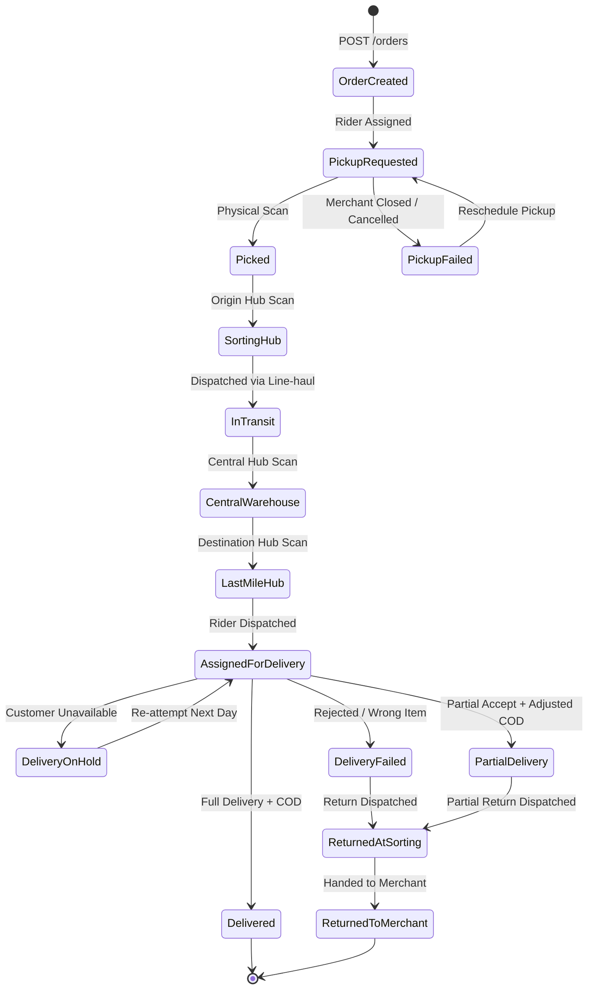

# Carrybee Lifecycle Status & Error Reference

This guide provides a comprehensive state machine breakdown of Carrybee consignment statuses, tracking event workflows, and error response resolution strategies.

---

## 1. Parcel Lifecycle State Machine

Carrybee parcels transition through distinct phases: First Mile, Hub Logistics, Last Mile Dispatch, Terminal Outcomes, and Reverse/Exchange loops.



---

## 2. Consignment Status Dictionary

| Status Key | Category | Operational Stage | Recommended Merchant Action |
|------------|----------|-------------------|-----------------------------|
| `created` | Pre-Transit | Order submitted, pending warehouse allocation | Prepare parcel package, stick Carrybee shipping label |
| `pickup_requested` | First Mile | Rider notified to pick up from store | Keep package accessible at pickup counter |
| `assigned_for_pickup` | First Mile | Rider assigned with phone number | Rider may contact merchant store manager |
| `picked` | First Mile | Parcel received and scanned by rider | Deduct stock from physical warehouse |
| `pickup_failed` | First Mile | Rider could not collect parcel | Check merchant operating hours & store address |
| `pickup_cancelled` | First Mile | Pickup request voided | Re-issue pickup or cancel consignment |
| `at_sorting_hub` | Logistics | Scanned at local origin sort center | Automated sorting and vehicle routing |
| `in_transit` | Logistics | Moving across highway / inter-district line-haul | In transit to destination city |
| `at_central_warehouse` | Logistics | Scanned at Dhaka central gateway | Secondary automated sortation |
| `received_at_last_mile_hub` | Last Mile | Arrived at recipient's neighborhood branch | Parcel staged for delivery route |
| `assigned_for_delivery` | Last Mile | Handed to delivery rider (Out for Delivery) | Send SMS alert to customer with rider contact |
| `delivery_on_hold` | Last Mile | Customer requested postponed date | Log callback schedule; wait for auto re-dispatch |
| `delivered` | Terminal | Successfully delivered, full payment collected | Update store order to `Completed`, balance credited |
| `partial_delivery` | Terminal | Customer kept partial items, remainder returning | Adjust order total, track reverse parcel return |
| `delivery_failed` | Terminal | Customer unreachable or refused parcel | Initiate customer care follow-up |
| `returned_at_sorting` | Reverse | Returned package moving back through hubs | Track reverse movement |
| `returned_to_merchant` | Terminal | Parcel physically returned back to store | Restock inventory, mark order `Returned` |
| `exchange_initiated` | Exchange | Replacement parcel dispatched with old pickup | Prepare replacement SKU |
| `exchange_completed` | Terminal | Swap confirmed and completed | Update inventory for exchanged SKU |
| `paid` | Financial | COD amount reconciled and disbursed to bank | Match with bank deposit reference |

---

## 3. HTTP Error Codes & Resolution

Carrybee uses standard HTTP status codes along with descriptive JSON error structures:

```json
{
  "success": false,
  "message": "Validation failed",
  "errors": {
    "item_weight": ["The item weight must be between 1 and 25000 grams."],
    "recipient_city": ["The selected recipient city is invalid."],
    "collectable_amount": ["The collectable amount must not exceed 100000 BDT."]
  }
}
```

### Common HTTP Status Codes

| HTTP Status | Meaning | Typical Trigger | Resolution |
|-------------|---------|-----------------|------------|
| `200 OK` | Request Succeeded | Successful query or status update | Parse `data` node in response |
| `201 Created` | Resource Created | New order or reverse pickup booked | Store `consignment_id` and tracking code |
| `202 Accepted` | Async Job / Handshake | Webhook verification handshake or bulk order queued | Echo `X-CB-Webhook-Integration-Header` |
| `400 Bad Request` | Malformed Request | Invalid JSON structure or missing parameters | Validate JSON syntax before sending |
| `401 Unauthorized` | Auth Failure | Invalid/expired `Client-ID`, `Client-Secret`, or `Client-Context` | Verify triple-header credentials in dashboard |
| `403 Forbidden` | Access Denied | Merchant account suspended or inactive | Contact Carrybee merchant support |
| `404 Not Found` | Not Found | Consignment ID or store ID does not exist | Verify IDs; check if queried in right environment |
| `422 Unprocessable` | Validation Error | Field out of bounds or invalid foreign ID | See Validation Error Matrix below |
| `429 Too Many Requests`| Rate Limit Exceeded | Exceeded 60 requests per minute | Implement exponential backoff retry |
| `500 Server Error` | Upstream Outage | Carrybee internal server exception | Retry after 30 seconds with idempotency key |

---

## 4. Validation Error Matrix (`422 Unprocessable Entity`)

| Field | Error Rule | Why It Fails | How to Fix |
|-------|------------|--------------|------------|
| `delivery_type` | `in:1,2` | Value other than `1` (Normal) or `2` (Express) | Send integer `1` or `2` |
| `product_type` | `in:1,2,3` | Value other than `1` (Parcel), `2` (Book), `3` (Document) | Pass integer `1`, `2`, or `3` |
| `item_weight` | `numeric|between:1,25000` | Sent in kg (e.g. `1.5`) instead of grams, or $>25\text{ kg}$ | Convert weight to integer grams: `1500` |
| `collectable_amount`| `numeric|min:0|max:100000` | Negative value or exceeding 1 Lakh BDT limit | Send `0` for prepaid, validate amount $\le 100,000$ |
| `recipient_phone` | `regex:/(01)[3-9]{1}[0-9]{8}/` | Missing leading `01`, 10 digits instead of 11 | Sanitize phone: format as `01XXXXXXXXX` |
| `recipient_city` | `exists:cities,id` | Invalid city ID passed | Call `GET /api/v2/cities` to fetch valid IDs |
| `recipient_zone` | `exists:zones,id` | Zone ID does not belong to the selected City | Call `GET /api/v2/zones/{city_id}` before submission |
| `store_id` | `exists:stores,id` | Non-existent warehouse store ID | Fetch active stores via `GET /api/v2/stores` |

---

## 5. Webhook vs Polling Best Practices

```mermaid
graph TD
    A[Order Placed] --> B[Rely on Webhooks as Primary]
    B --> C{Webhook Arrived within 4 Hours?}
    C -- Yes --> D[Update DB State Idempotently]
    C -- No / Out of Sync --> E[Fallback Scheduled Poller]
    E --> F[GET /api/v2/orders/track/{consignment_id}]
    F --> D
```

- **Idempotency**: Always check your local order state before applying webhook updates. Network retries can dispatch duplicate events.
- **Fail-safe Poller**: Run a scheduled cron job every 4 hours for active, non-delivered orders to query `GET /api/v2/orders/track/{consignment_id}` to reconcile any missed webhook deliveries.
- **Speed**: Carrybee webhooks are dispatched with a 5-second SLA following physical barcode scans by riders and hub operators.
