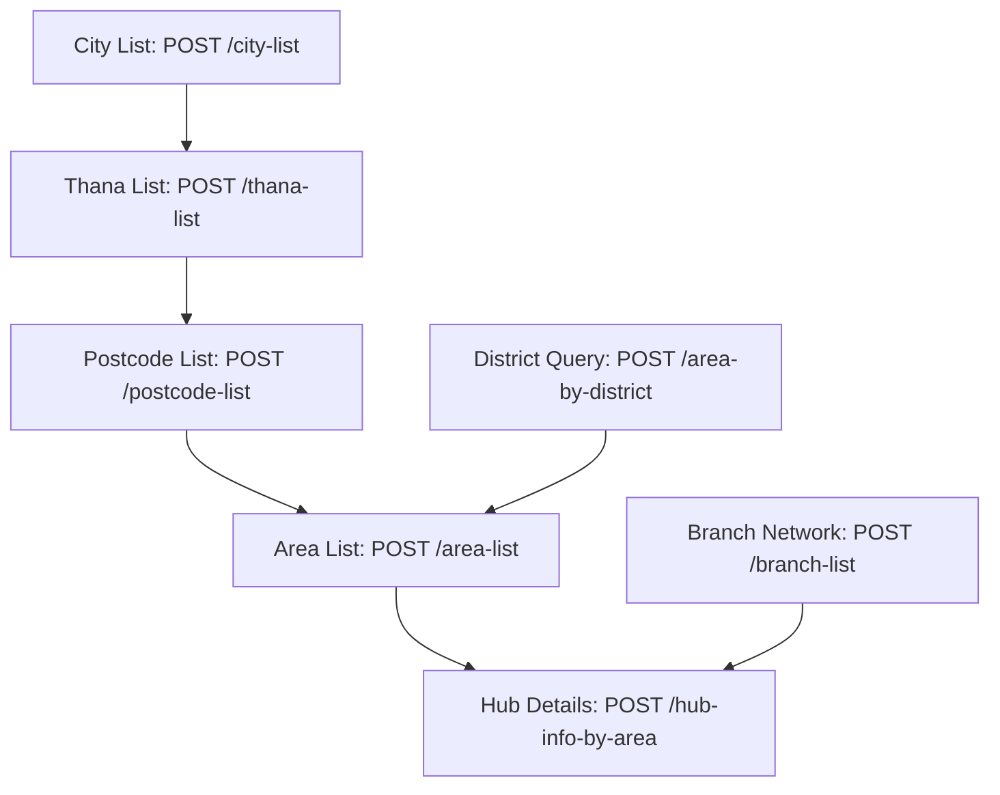

# 02. Coverage & Geographic Engine

eCourier provides a comprehensive suite of geographic endpoints to resolve recipient delivery addresses from high-level administrative divisions down to specific delivery hubs and postal zones.

---

## 1. Geographic Resolution Hierarchy



---

## 2. City List (`POST /city-list`)

Retrieves the list of all operational cities and major administrative districts.

### Request
- **Method**: `POST`
- **Path**: `/city-list`
- **Body**: `{}` (Empty JSON object)

```bash
curl -X POST "https://staging.ecourier.com.bd/api/city-list" \
  -H "API-KEY: YOUR_API_KEY" \
  -H "API-SECRET: YOUR_API_SECRET" \
  -H "USER-ID: YOUR_USER_ID" \
  -H "Content-Type: application/json"
```

### Response
```json
[
  {
    "name": "Dhaka",
    "value": "Dhaka"
  },
  {
    "name": "Chattogram",
    "value": "Chattogram"
  },
  {
    "name": "Barishal",
    "value": "Barishal"
  },
  {
    "name": "Sylhet",
    "value": "Sylhet"
  }
]
```

---

## 3. Thana List (`POST /thana-list`)

Fetches all sub-districts (Thanas / Upazilas) under a given city.

### Request Body
```json
{
  "city": "Barishal"
}
```

### Response
```json
{
  "success": true,
  "message": [
    {
      "name": "Agailjhara",
      "value": "Agailjhara"
    },
    {
      "name": "Babuganj",
      "value": "Babuganj"
    },
    {
      "name": "Bakerganj",
      "value": "Bakerganj"
    }
  ]
}
```

---

## 4. Postcode List (`POST /postcode-list`)

Resolves applicable postal codes based on the selected city and thana.

### Request Body
```json
{
  "city": "Barishal",
  "thana": "Babuganj"
}
```

### Response
```json
{
  "success": true,
  "message": [
    {
      "name": "8210(Babuganj)",
      "value": "8210"
    },
    {
      "name": "8217(Babuganj Bondor)",
      "value": "8217"
    }
  ]
}
```

---

## 5. Area List by Postcode (`POST /area-list`)

Retrieves localized delivery neighborhoods or sub-areas under a postal code.

### Request Body
```json
{
  "postcode": "1212"
}
```

### Response
```json
{
  "success": true,
  "message": [
    {
      "name": "Abdullah Bag",
      "value": "Abdullah Bag"
    },
    {
      "name": "Adorsho Nagor",
      "value": "Adorsho Nagor"
    },
    {
      "name": "Badda",
      "value": "Badda"
    },
    {
      "name": "Gulshan-2",
      "value": "Gulshan-2"
    }
  ]
}
```

---

## 6. Area by District (`POST /area-by-district`)

A shortcut endpoint to retrieve all area entries under an entire district directly, complete with corresponding `hub_id`.

### Request Body
```json
{
  "district": "Dhaka"
}
```

### Response
```json
{
  "success": true,
  "data": [
    {
      "id": 2,
      "hub_id": 1,
      "post_code": "1212",
      "name": "Gulshan-2"
    },
    {
      "id": 5,
      "hub_id": 18490,
      "post_code": "1212",
      "name": "Badda"
    }
  ]
}
```

---

## 7. Hub Info by Area Name (`POST /hub-info-by-area`)

Looks up the designated destination delivery hub responsible for a specific recipient area name.

### Request Body
```json
{
  "area": "Gulshan-2"
}
```

### Response
```json
{
  "success": true,
  "message": "Hub details",
  "data": {
    "hub_name": "Badda Hub",
    "hub_id": 18490,
    "hub_mobile": "01402876962",
    "address": "House 14, Middle Badda, Dhaka",
    "latitude": "23.56456",
    "longitude": "90.4344"
  }
}
```

---

## 8. Branch List (`POST /branch-list`)

Returns all physical eCourier offices, sorting gateways, and branch hubs.

### Request
```bash
curl -X POST "https://staging.ecourier.com.bd/api/branch-list" \
  -H "API-KEY: YOUR_API_KEY" \
  -H "API-SECRET: YOUR_API_SECRET" \
  -H "USER-ID: YOUR_USER_ID" \
  -H "Content-Type: application/json"
```

### Response
```json
{
  "success": true,
  "message": [
    {
      "name": "Andarkilla Hub",
      "value": 57
    },
    {
      "name": "Badda Hub",
      "value": 18490
    },
    {
      "name": "Uttara Hub",
      "value": 12
    }
  ]
}
```
