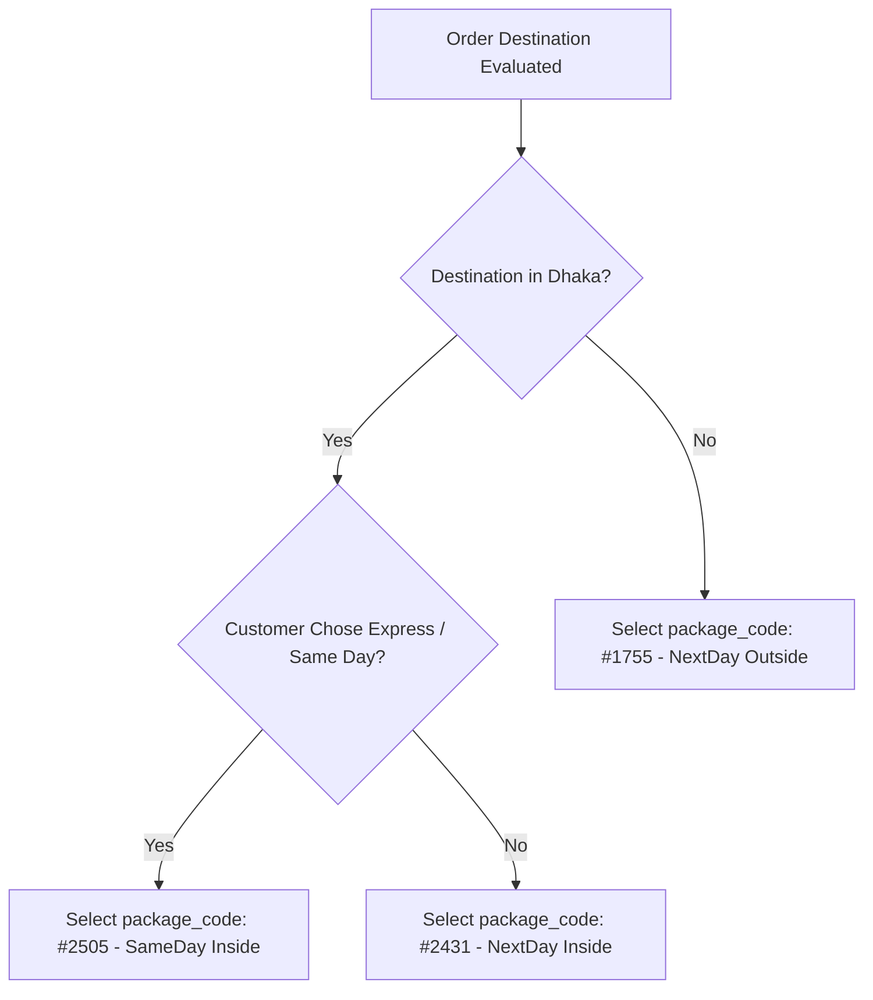

# 03. Package Selection & Pricing

Unlike platforms with static, hardcoded rate tiers, eCourier binds specific **Package Codes** to each merchant account based on their commercial service agreement (SLA, delivery speed, and coverage scope).

---

## 1. Fetching Assigned Packages (`POST /packages`)

Before placing orders, your application should query or cache the list of active packages assigned to your merchant credentials.

### Request
- **Method**: `POST`
- **Path**: `/packages`
- **Headers**: Standard triple-header auth
- **Body**: `{}`

```bash
curl -X POST "https://staging.ecourier.com.bd/api/packages" \
  -H "API-KEY: YOUR_API_KEY" \
  -H "API-SECRET: YOUR_API_SECRET" \
  -H "USER-ID: YOUR_USER_ID" \
  -H "Content-Type: application/json"
```

### Response
```json
[
  {
    "package_name": "SAMEDAY_Inside_120tk",
    "package_code": "#2505",
    "shipping_charge": "120",
    "weight": "Up To 500gm",
    "delivery_time": "Same Day(8Hr)",
    "coverage_id": "1",
    "coverage": "Inside Dhaka"
  },
  {
    "package_name": "NEXTDAY_Inside_60tk",
    "package_code": "#2431",
    "shipping_charge": "60",
    "weight": "Up To 1kg",
    "delivery_time": "Next Day(24hr)",
    "coverage_id": "1",
    "coverage": "Inside Dhaka"
  },
  {
    "package_name": "NEXTDAY_Outside_130tk",
    "package_code": "#1755",
    "shipping_charge": "130",
    "weight": "Up To 1kg",
    "delivery_time": "Next Day(24hr)",
    "coverage_id": "2",
    "coverage": "Outside Dhaka"
  }
]
```

---

## 2. Package Schema Definition

| Property | Type | Description |
| :--- | :--- | :--- |
| `package_name` | `string` | Human-readable service label |
| `package_code` | `string` | **Mandatory identifier** required by `/order-place` (e.g. `#2431`) |
| `shipping_charge` | `string` | Contracted courier delivery fee in BDT |
| `weight` | `string` | Included maximum base weight tier (e.g. `Up To 500gm`, `Up To 1kg`) |
| `delivery_time` | `string` | SLA delivery window (e.g. `Same Day(8Hr)`, `Next Day(24hr)`) |
| `coverage_id` | `string` | Internal zone classifier (`1` = Inside Dhaka, `2` = Outside Dhaka) |
| `coverage` | `string` | Textual coverage name |

---

## 3. Dynamic Package Selection Logic

When an ecommerce checkout completes, your backend should dynamically determine the correct `package_code`:



> [!WARNING]
> **Invalid Package Error**: Passing a `package_code` that is not assigned to your merchant account yields an HTTP 400 error:
> ```json
> {
>   "errors": [
>     "Invalid Package",
>     "The Package code does not exist or assigned to you"
>   ],
>   "response_code": 400
> }
> ```
