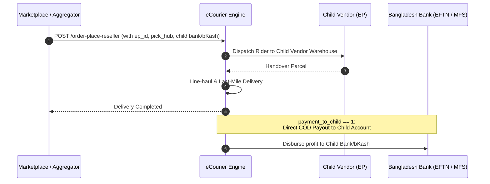

# 05. Reseller Orders & Child Profit Splitting

eCourier offers a dedicated multi-vendor reseller architecture tailored for aggregators, marketplaces, dropshipping networks, and franchise networks. 

This architecture allows a parent merchant account to book parcels originating from distinct child vendor warehouses while automatically routing COD revenues directly to the child vendor's bank account, bKash, or Rocket wallet.

---

## 1. Reseller Architecture Flow



---

## 2. Reseller Booking Endpoint (`POST /order-place-reseller`)

### Key Input Parameters

In addition to standard recipient details, the reseller endpoint introduces vendor pickup and financial payout routing parameters:

| Parameter | Type | Required? | Description |
| :--- | :---: | :---: | :--- |
| `ep_name` | `string` | No | Child eCommerce Partner (EP) business name |
| `ep_id` | `integer`| **Yes** | Unique partner/vendor identifier in your system |
| `pick_contact_person`| `string`| No | Contact person at the child vendor warehouse |
| `pick_district` | `string` | **Yes** | District where child warehouse is located |
| `pick_thana` | `string` | **Yes** | Thana of the child warehouse |
| `pick_union` | `string` | **Yes** | Postal ZIP code of the child warehouse |
| `pick_address` | `string` | **Yes** | Full address of the child vendor warehouse |
| `pick_mobile` | `string` | **Yes** | Child vendor contact phone number |
| `pick_hub` | `integer`| **Yes** | eCourier branch hub ID serving this pickup location |
| `payment_to_child` | `integer`| No | `1` = Disburse payout to Child, `2` = Disburse to Parent |
| `child_payment_method`| `string` | No | Case-sensitive: `Bank`, `EFTN`, `Bkash`, `Rocket` |
| `child_account` | `string` | Conditional | Bank account number (Required if Bank/EFTN) |
| `child_bank_name` | `string` | Conditional | Bank name (e.g. `BRAC Bank`, `City Bank`) |
| `child_bank_branch` | `string` | Conditional | Bank branch name |
| `child_account_holder_name`| `string` | Conditional | Account title matching bank records |
| `child_account_route`| `string` | Conditional | 9-digit Bangladesh Bank routing number |
| `child_bkash` | `string` | Conditional | 11-digit bKash wallet number |
| `child_bkash_type` | `string` | Conditional | `Personal` or `Agent` |
| `parcel_detail` | `string` | No | Serialized item JSON array (names and quantities) |

---

## 3. Sample Reseller Payload (bKash Payout)

```json
{
  "product_id": "RS-2026-881",
  "ep_name": "Artisan Craft Studio",
  "ep_id": 48201,
  "pick_contact_person": "Mahbubur Rahman",
  "pick_division": "Dhaka",
  "pick_district": "Dhaka",
  "pick_thana": "Badda",
  "pick_hub": 18490,
  "pick_union": "1212",
  "pick_address": "House 12, Road 5, Middle Badda, Dhaka",
  "pick_mobile": "01711223344",
  "recipient_name": "Farhana Yasmin",
  "recipient_mobile": "01822334455",
  "recipient_city": "Chattogram",
  "recipient_thana": "Panchlaish",
  "recipient_area": "Muradpur",
  "recipient_address": "House 45, Road 2, Nasirabad Housing",
  "recipient_zip": "4000",
  "package_code": "#1755",
  "product_price": 2450,
  "payment_method": "COD",
  "number_of_item": 2,
  "actual_product_price": 2200,
  "payment_to_child": 1,
  "child_payment_method": "Bkash",
  "child_bkash": "01711223344",
  "child_bkash_type": "Personal",
  "parcel_detail": "[{\"product_name\":\"Handmade Clay Pot\",\"quantity\":2}]",
  "comments": "Fragile handicraft item"
}
```

---

## 4. Child Parcel Tracking (`POST /track-child`)

Reseller child consignments can be tracked independently using either the child tracking endpoint or standard tracking.

### Request Body
```json
{
  "ecr": "ECR1030102170392"
}
```

---

## 5. Child Parcel Cancellation (`POST /cancel-order-child`)

Allows cancelling a child parcel consignment while still in the pre-pickup `Initiated` state.

### Request Body
```json
{
  "tracking": "ECR1030102170392",
  "comment": "Customer cancelled order before pickup"
}
```

### Response
```json
{
  "success": true,
  "message": "Order canceled"
}
```
