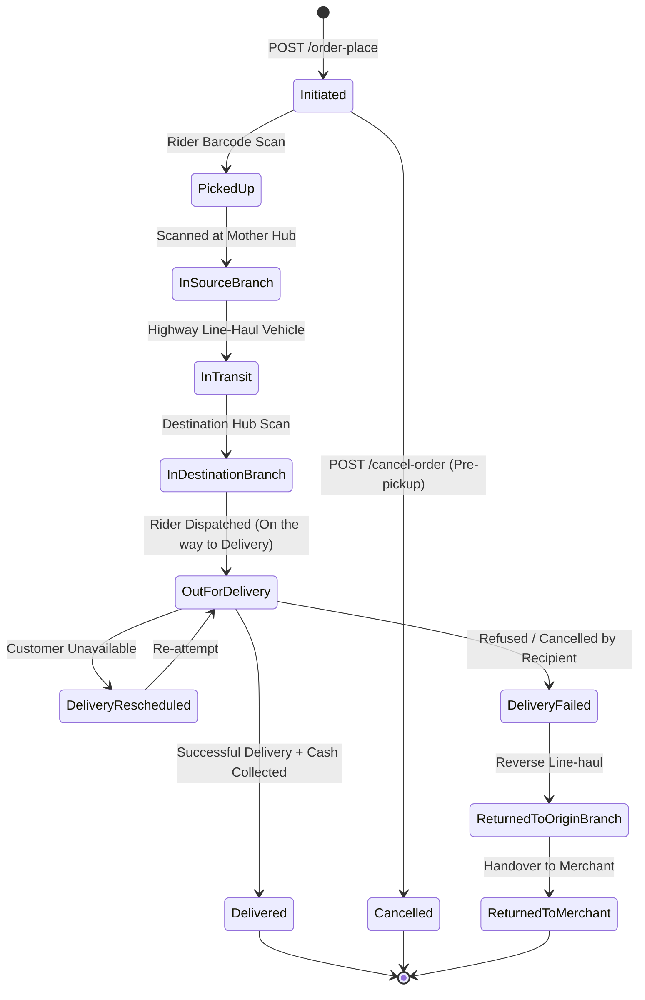

# 08. Status Codes, Errors & Best Practices

A complete reference for eCourier tracking lifecycle states, HTTP status definitions, operational error codes, and production safeguards.

---

## 1. Parcel Lifecycle State Machine



---

## 2. Tracking Status Dictionary

| Status Key | Operational Stage | Description | Recommended System Action |
| :--- | :--- | :--- | :--- |
| `Initiated` | Booking | Order booked via API; rider pickup pending | Prepare parcel and print thermal barcode label |
| `Picked Up` | First Mile | Physical handover completed to rider | Deduct item from inventory warehouse |
| `In Source Branch` | Logistics | Scanned at local origin sortation center | Batch consolidation |
| `In Transit` | Line-haul | Dispatched between inter-district gateways | Inter-district highway transport |
| `In Destination Branch` | Last Mile | Arrived at recipient's neighborhood sub-hub | Staged for delivery manifest |
| `On the way to Delivery` | Last Mile | Handed to delivery rider (Out for Delivery) | Send customer SMS with expected arrival |
| `Delivered` | Terminal | Parcel delivered, COD collected | Mark order `Completed`, await payment status |
| `Order canceled` | Terminal | Order cancelled via API prior to rider collection | Restock inventory SKU |
| `Returned to Merchant` | Reverse Terminal| Parcel returned to merchant warehouse | Inspect parcel condition and process restock |

---

## 3. HTTP Status Codes & Error Dictionary

| HTTP Code | Error Condition | Underlying Trigger | Resolution |
| :---: | :--- | :--- | :--- |
| `200` | Success | Request accepted and processed | Parse response JSON body |
| `203` | Non-Authoritative / Warning | Insufficient COD balance for VAS | Check pending COD balance before Booster SMS / Top-up |
| `204` | No Content / SMS Failed | SMS delivery rejected by telco | Verify recipient phone number format |
| `206` | Partial Success | Some numbers delivered in SMS broadcast | Check `wrong` array in response |
| `400` | Bad Request | Validation failure or missing parameters | See Specific 400 Errors below |
| `401` | Unauthorized | Bad `API-KEY`, `API-SECRET`, or `USER-ID` | Audit triple headers in backoffice portal |
| `404` | Not Found | Masking title or resource missing | Contact eCourier support to configure brand masking |
| `406` | Not Acceptable | SMS billing rate not defined | Request rate contract enablement from account manager |
| `500` | Server Error | Database failure at eCourier gateway | Exponential backoff retry after 30 seconds |

---

## 4. Specific 400 Validation Error Causes

### A. Missing Mandatory Parameter
```json
{
  "errors": [
    "Invalid Request",
    "recipient_name Parameter either missing or not set correctly. "
  ],
  "response_code": 400
}
```
**Fix**: Ensure `recipient_name`, `recipient_mobile`, `recipient_city`, `recipient_thana`, `recipient_area`, `recipient_address`, `package_code`, `product_price`, and `payment_method` are populated.

### B. Invalid Package Code
```json
{
  "errors": [
    "Invalid Package",
    "The Package code does not exist or assigned to you"
  ],
  "response_code": 400
}
```
**Fix**: Query `POST /packages` to confirm your contracted package codes. Do not invent arbitrary `#code` strings.

### C. Zero Price with COD Method
```json
{
  "errors": [
    "Invalid Request",
    "Product price 0 not allow in BOD and COD payment method"
  ],
  "response_code": 400
}
```
**Fix**: If customer already paid online (prepaid), set `payment_method: "CCRD"` or `"MPAY"` and pass `product_price: 0`.

### D. Duplicate Order Submission
```json
{
  "errors": [
    "Invalid Request",
    "Duplicate product id and mobile supplied"
  ],
  "response_code": 400
}
```
**Fix**: Ensure `product_id` is unique per merchant order invoice. If re-attempting, append an attempt suffix (e.g. `INV-901-R1`).
