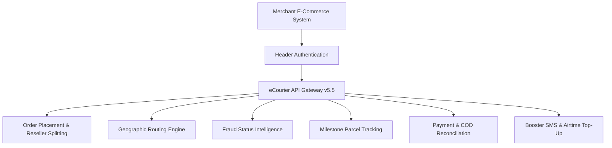

# 📦 eCourier Developer API Suite (v5.5)

Official technical reference, integration guides, and client libraries for the **eCourier Courier Delivery Platform** (a dotlines initiative), Bangladesh.

Maintained with Silicon Valley engineering standards by **Refat Rahman** ([refat.ovh](https://refat.ovh) | [@refatbd](https://github.com/refatbd)).

---

## 1. Architectural Overview & Highlights

eCourier is one of the pioneer technology-driven logistics and 3PL courier platforms in Bangladesh, offering:
- **Nationwide Coverage**: Doorstep delivery across all 64 districts with automated City, Thana, Postcode, and Hub routing.
- **Dedicated Reseller / Child-Merchant Splitting**: Native support for parent ecommerce aggregators (`/order-place-reseller`) with automated bank/bKash/Rocket profit distribution.
- **AI Fraud Detection**: Built-in `/fraud-status-check` endpoint to assess customer delivery return probability and past order completion history.
- **Instant COD Settlement (iPay & Payment Status)**: Automated merchant COD payout status with detailed deductions breakdown (`/payment-status`).
- **Integrated Booster Value-Added Services**: In-house SMS broadcasting (`/bs-sms`), OTP delivery (`/bs-top-otp`), and automated mobile airtime recharge (`/bs-top`).
- **Dynamic PDF Invoicing**: High-speed shipping barcode label generation (`/label-print`).



---

## 2. Environment Endpoints

| Environment | Base URL | Purpose |
| :--- | :--- | :--- |
| **Sandbox / Staging** | `https://staging.ecourier.com.bd/api` | Development testing, payload verification, and mock fulfillment |
| **Production / Live** | `https://backoffice.ecourier.com.bd/api` | Real-time commercial orders, rider pickup dispatch, and live COD |

---

## 3. Triple-Header Authentication

Every request to eCourier must include three credentials passed as HTTP headers along with `Content-Type: application/json`:

```http
API-KEY: YOUR_MERCHANT_API_KEY
API-SECRET: YOUR_MERCHANT_API_SECRET
USER-ID: YOUR_MERCHANT_USER_ID
Content-Type: application/json
```

> [!IMPORTANT]
> **HTTP POST Convention**: Unlike many RESTful services that use `GET` for listing data, **eCourier strictly enforces HTTP POST for all endpoints**, including read-only operations like `/city-list`, `/packages`, and `/branch-list`.

---

## 4. Complete Endpoints Summary Matrix (21 Endpoints)

| # | Endpoint Path | Method | Category | Functionality |
|---|---------------|:------:|----------|---------------|
| 1 | `/order-place` | `POST` | Orders | Standard delivery order placement (COD, POS, MPAY, CCRD) |
| 2 | `/order-place-reseller` | `POST` | Reseller | Multi-vendor reseller order with automatic child payout split |
| 3 | `/track` | `POST` | Tracking | Real-time milestone tracking by `ecr` ID or `product_id` |
| 4 | `/track-child` | `POST` | Reseller | Track child/sub-merchant consignment |
| 5 | `/packages` | `POST` | Packages | Retrieve merchant's contracted package codes and rates |
| 6 | `/cancel-order` | `POST` | Orders | Cancel consignment in `Initiated` or `Initiated API` state |
| 7 | `/cancel-order-child` | `POST` | Reseller | Cancel child consignment |
| 8 | `/fraud-status-check` | `POST` | Security | Check customer fraud risk status by phone number |
| 9 | `/city-list` | `POST` | Coverage | Fetch all serviceable cities |
| 10 | `/thana-list` | `POST` | Coverage | Fetch thanas / upazilas under a specific city |
| 11 | `/area-list` | `POST` | Coverage | Fetch localized areas under a specific postal code |
| 12 | `/postcode-list` | `POST` | Coverage | Fetch postal codes by city and thana |
| 13 | `/area-by-district` | `POST` | Coverage | Query areas by district name |
| 14 | `/branch-list` | `POST` | Logistics | List all operational eCourier branch hubs |
| 15 | `/hub-info-by-area` | `POST` | Logistics | Retrieve hub name, ID, phone, and GPS coords by area |
| 16 | `/payment-status` | `POST` | Finance | Reconcile COD collection, deductions, and payment date |
| 17 | `/label-print` | `POST` | Documents | Retrieve downloadable thermal PDF barcode label URL |
| 18 | `/bs-sms` | `POST` | Booster VAS | Send promotional or transactional SMS (Masking / Non-masking) |
| 19 | `/bs-top` | `POST` | Booster VAS | Recharge mobile airtime via COD balance deduction |
| 20 | `/bs-top-status` | `POST` | Booster VAS | Check transaction status of mobile airtime top-up |
| 21 | `/bs-top-otp` | `POST` | Booster VAS | Dispatch one-time passcode (OTP) SMS |

---

## 5. Chapter Navigation

1. [**01. Getting Started & Authentication**](01-getting-started.md)
2. [**02. Coverage & Geographic Engine**](02-coverage-and-geography.md)
3. [**03. Package Selection & Pricing**](03-package-selection.md)
4. [**04. Order Placement (General & Exchange)**](04-order-placement.md)
5. [**05. Reseller Orders & Child Profit Splitting**](05-reseller-and-child-orders.md)
6. [**06. Milestone Tracking, Label Print & Finance**](06-tracking-labels-and-finance.md)
7. [**07. AI Fraud Check & Booster VAS Services**](07-fraud-check-and-booster-sms.md)
8. [**08. Status Codes, Errors & Best Practices**](08-status-and-error-reference.md)
