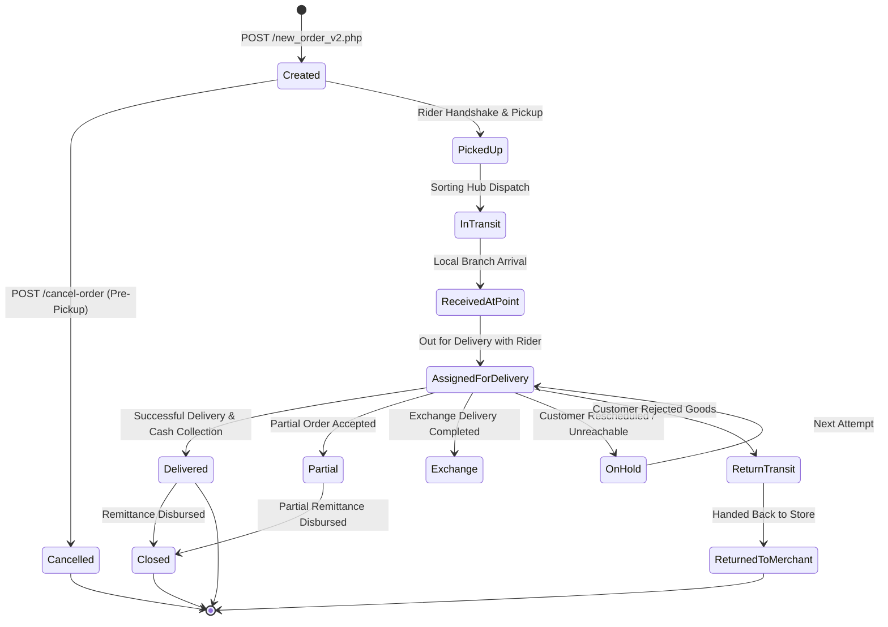

# 07. Status Codes & Lifecycle Reference

This document maps Paperfly's end-to-end logistics lifecycle, state machine transitions, and common HTTP error scenarios.

---

## 🔄 Parcel Lifecycle State Diagram

---

## 📋 Tracking Milestone Field Reference

When querying `POST /API-Order-Tracking`, inspect these milestone fields:

| Field Name | Type | Value | Meaning |
| :--- | :---: | :---: | :--- |
| `Pick` | `string`/`null` | `"Y"` or `null` | `"Y"` if consignment was collected by pickup rider. |
| `inTransit` | `string` | `"Y"` or `""` | `"Y"` if package is travelling through national sorting line-haul. |
| `ReceivedAtPoint` | `string` | `"Y"` or `""` | `"Y"` if received at local last-mile distribution point. |
| `PickedForDelivery`| `string` | `"Y"` or `""` | `"Y"` if assigned to courier rider for final delivery. |
| `Delivered` | `string` | `"Y"` or `""` | `"Y"` if successfully handed over to customer. |
| `onHoldSchedule` | `string` | `"YYYY-MM-DD"` | Holds rescheduling date if delivery attempt was deferred. |
| `Partial` | `string` | `"Y"` or `""` | `"Y"` if customer retained partial merchandise. |
| `Returned` | `string` | `"Y"` or `""` | `"Y"` if shipment was refused and returned to merchant. |
| `close` | `string` | `"Y"` or `""` | `"Y"` when billing reconciliation is complete. |

---

## ⚠️ Common HTTP Errors & Troubleshooting

| HTTP Status | Error Cause | Resolution |
| :---: | :--- | :--- |
| **`401 Unauthorized`** | Missing Basic Auth or missing `paperflykey: Paperfly_~La?Rj73FcLm` header. | Verify Base64 encoding of `username:password` and exact spelling of `paperflykey`. |
| **`400 Bad Request`** | Missing mandatory parameter (e.g. `customerPhone` or `merchantOrderReference`). | Validate JSON payload against schema before dispatching. |
| **`422 Unprocessable`** | Invalid phone format (not 11 digits) or weight out of range. | Format phone to `01XXXXXXXXX` and ensure weight is numeric string. |
| **`500 Server Error`** | Temporary upstream database timeout. | Implement retry with backoff. |
