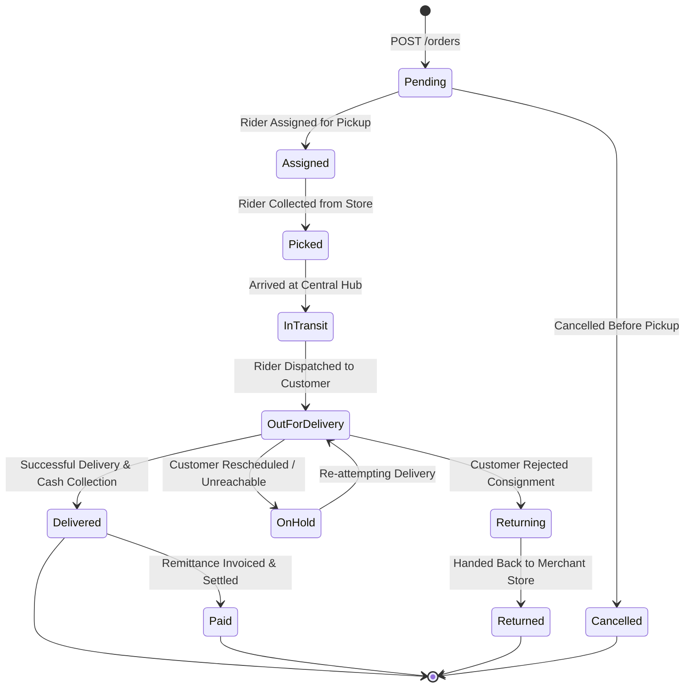

# 08. Status Lifecycle, State Machine & Errors

Understanding Pathao's shipment state machine enables merchants to automate customer SMS alerts, synchronize inventory, and reconcile remittance payouts reliably.

---

## 🔄 Pathao Order Lifecycle State Diagram

---

## 📋 Standard Status Definitions

| Status Slug | Phase | Description & Recommended Action |
| :--- | :---: | :--- |
| `Pending` | Booking | Order booked. Waiting for automated dispatch algorithm to assign a pickup rider. |
| `Assigned` | Pickup | Pickup rider assigned with contact info visible on merchant panel. |
| `Picked` | Pickup | Package physically collected from merchant warehouse. |
| `In Transit` | Sorting | Consignment is traversing regional sorting hubs. |
| `Out for Delivery` | Last-Mile | Last-mile rider has departed hub with the package. Trigger "Out for delivery" SMS. |
| `Delivered` | Fulfilled | Recipient accepted package and paid COD. Mark internal order as "Completed". |
| `On Hold` | Exception | Delivery attempt failed due to recipient unreachable or address ambiguity. |
| `Returning` | Reverse | Delivery aborted after multiple attempts or recipient refusal. Package returning to origin. |
| `Returned` | Returned | Package returned to merchant store. Restock inventory items. |
| `Paid` | Settlement | Collected COD funds settled to merchant bank account (Invoice generated). |
| `Cancelled` | Aborted | Order cancelled by merchant prior to rider pickup. |

---

## 🚚 System Codes Quick Reference

### Delivery Types (`delivery_type`)

- **`48`**: Normal Next-Day Standard Delivery (Available nationwide).
- **`12`**: On-Demand Same-Day Express Delivery (Available in select metro areas).

### Item Types (`item_type`)

- **`1`**: Document / Letter / Envelope.
- **`2`**: Parcel / Box / Physical Merchandise.

---

## ⚠️ Common HTTP Errors & Resolutions

| HTTP Status | Typical Root Cause | Recommended Fix |
| :---: | :--- | :--- |
| **`400 Bad Request`** | Invalid phone length (not 11 digits), missing store ID, or negative amount. | Verify phone format (`01XXXXXXXXX`) and parameters before sending. |
| **`401 Unauthorized`** | Missing or expired Bearer access token. | Catch 401 error, execute `grant_type: refresh_token`, and retry request. |
| **`403 Forbidden`** | Deactivated merchant account or unapproved store ID. | Ensure store is active (`is_active: 1`) via `GET /stores`. |
| **`404 Not Found`** | Specified `consignment_id` does not exist. | Validate consignment ID format. |
| **`422 Unprocessable`** | Weight out of bounds (less than 0.5 kg or greater than 10.0 kg). | Clamp weight to `0.5 <= weight <= 10.0`. |
| **`500 Server Error`** | Pathao internal database or gateway glitch. | Implement exponential backoff retry. |
