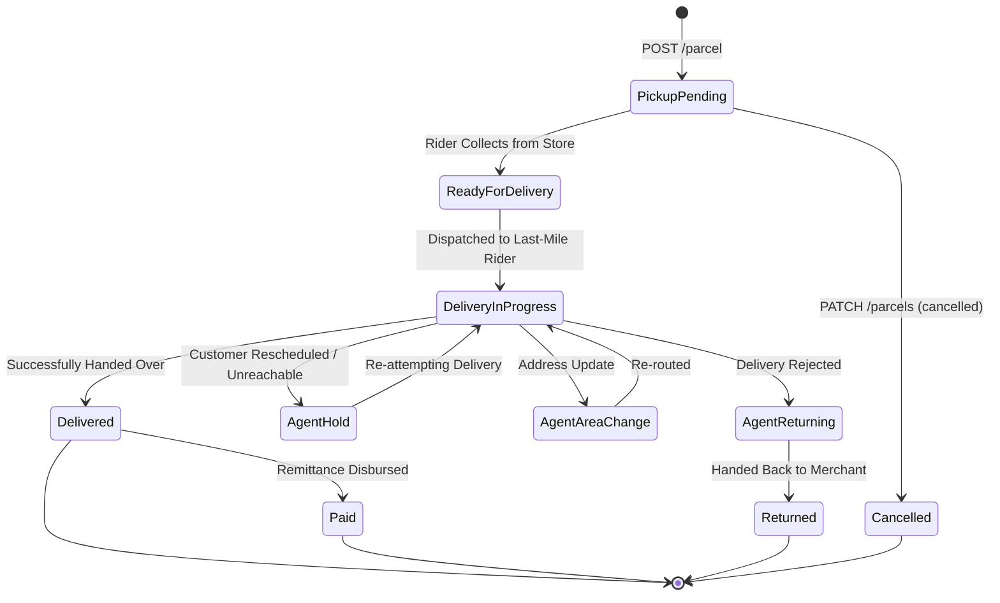

# 08. Status Codes & Error Reference

This guide provides a reference for the RedX parcel lifecycle state machine, status transitions, HTTP response codes, and production error-handling strategies.

---

## 🔄 Parcel Lifecycle State Diagram



---

## 📋 Comprehensive Status Code Reference

| Status Slug | Phase | Description |
| :--- | :---: | :--- |
| `pickup-pending` | Pre-Transit | The booking has been created in RedX system, waiting for rider pickup. |
| `ready-for-delivery` | In-Transit | The parcel has been collected from warehouse and arrived at central sorting hub. |
| `delivery-in-progress`| Last-Mile | Dispatched to the final delivery rider in the destination area. |
| `delivered` | Fulfillment | Rider successfully delivered parcel to recipient and collected COD amount. |
| `agent-hold` | Exception | Delivery delayed due to customer unavailability, incorrect phone, or customer request. |
| `agent-area-change` | Exception | Destination address changed; shipment is being re-routed to a different delivery hub. |
| `agent-returning` | Reverse | Delivery failed or customer refused goods; returning back towards merchant warehouse. |
| `returned` | Reverse | Shipment physically returned to merchant. No COD collected. |
| `paid` | Settlement | Collected COD cash disbursed to merchant's bank or mobile financial account. |
| `cancelled` | Aborted | Order cancelled by merchant prior to pickup via `PATCH /parcels`. |

---

## ⚠️ HTTP Error Handling & Semantics

| HTTP Code | Error Scenario | Resolution |
| :---: | :--- | :--- |
| **`400 Bad Request`** | Invalid body parameters, invalid `area_id`, or negative cash collection. | Validate payload against schema before dispatching. |
| **`401 Unauthorized`** | Missing or expired `API-ACCESS-TOKEN: Bearer <token>` header. | Re-generate token from dashboard and verify header key spelling. |
| **`404 Not Found`** | Specified `tracking_id` or `pickup_store_id` does not exist. | Check tracking ID format or verify store registration. |
| **`422 Unprocessable`** | Delivery area not serviceable or phone number format invalid. | Ensure recipient phone is a valid 11-digit Bangladeshi mobile number (`01XXXXXXXXX`). |
| **`500 Server Error`** | Temporary upstream infrastructure failure. | Implement exponential backoff retry (e.g. 1s, 2s, 4s, 8s). |

---

## 🛡️ Best Practices for Production Systems

1. **Phone Number Sanitization:**
   Always strip leading country codes (`+880` or `880`) and whitespace before transmitting:
   ```javascript
   function sanitizeBDPhone(phone) {
     let clean = phone.replace(/\D/g, '');
     if (clean.startsWith('880')) clean = clean.substring(2);
     return clean;
   }
   ```
2. **Idempotency Strategy:**
   Store RedX `tracking_id` alongside your local `order_id` in your relational database immediately upon receiving the `POST /parcel` response. If your server crashes before saving, use `merchant_invoice_id` to reconcile rather than re-creating duplicate parcels.
3. **Webhook Verification:**
   Always guard your webhook listener route with an authorization token query parameter (`?token=...`) to prevent spoofed status updates.
